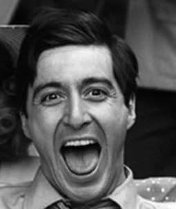

<h1>Баранов Роман</h1>

---

## Контактная информация:

| | |
|---|---|
| Email | brotisska228@gmail.com |
| Telegram | @evgnoprig |
| Телефон | +7 903 833-93-21 |

---

## Немного о себе:

### Образование:
- Неоконченное высшее (в данный момент студент 1 курса СПбГУ на направлении Программирование и информационные технологии)
- Имею предпрофессиональное художественное образование (закончил Художественную школу г.Коврова)
- прошел оналйн-курс ""Поколение Python": курс для начинающих" на платформе Stepik
- прошел онлайн-курс "Основы статистики" на платформе Stepik

### Цели и приоритеты:
Хочу и дальше развиваться в IT. На данный момент ставлю себе целью углубиться в Machine Learning и Data Science.

### Сильные стороны:
- Обучаемость
- Стрессоутойчивость
- Умение ставить цели и достигать их
- Умение влиться в коллектив
- Открытость ко всему новому
- Люблю решать сложные задачи

---

## Навыки:

| Категория | Технологии |
|---|---|
| **Языки программирования** | [Python, C++] |
| **Фреймворки и библиотеки** | [Django, Pandas, Seaborn, Pygame] |
| **Системы контроля версий** | [Git, GitHub] |
| **Инструменты разработки** | [VS Code, PyCharm] |

---

## Иностранные языки

| Язык | Уровень |
|---|---|
| Английский | B2 – Intermediate+ |

---

## Проекты

- https://github.com/KarlFillipovich/Learning_log
- https://github.com/KarlFillipovich/amcp-cv

---
